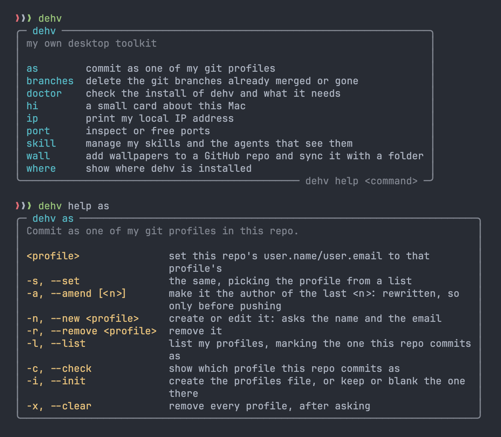

# dehv

My own command line tool for macOS: every personal function lives behind this one name, as `dehv <command> [options] [args]`, so none can clash with a system command. It is plain zsh: an executable, a library of helpers and one file per command, installed with Homebrew.

## Contents

- [Install](#install)
- [What it needs](#what-it-needs)
- [Where things are](#where-things-are)
- [Commands](#commands)
- [Config](#config)
- [In the repo](#in-the-repo)
- [Working on it](#working-on-it)
- [Adding a command](#adding-a-command)

## Install

From my Homebrew tap:

```sh
brew install de-hv/tap/dehv
```

It is a plain executable: brew links `dehv` into its `bin` and the completion into its `site-functions`, so nothing goes in `~/.zshrc`. A new terminal completes `dehv <tab>` if the rc file already loads Homebrew's completions, as Homebrew's own setup does.

| Command | Does |
|---|---|
| `brew upgrade dehv` | update it |
| `brew uninstall dehv` | uninstall it; `~/.config/dehv` stays |

To see the `dehv hi` card in every new terminal, add `dehv hi` to `~/.zshrc` by hand.

## What it needs

`dehv doctor` checks it, with exit code 1 when something required is missing.

| Needs | From |
|---|---|
| zsh 5.8 or newer | macOS |
| `git` | Apple's Command Line Tools (`xcode-select --install`) |
| `curl`, `lsof`, `pbcopy`, `osascript`, `sips`, `networksetup` | macOS: they come with every Mac |
| `gh` (optional) | Homebrew (`brew install gh`). Only `dehv wall` uses it, to choose ssh or https for `owner/name` urls |

`/usr/bin/git` exists on every Mac, but until the Command Line Tools are installed it only offers to install them, so git counts once `xcode-select -p` answers.

## Where things are

| Path | What |
|---|---|
| `$(brew --prefix)/bin/dehv` | the command, a link to the formula's `libexec/bin/dehv` |
| `$(brew --prefix)/opt/dehv/libexec` | `lib.zsh`, `commands/` and `VERSION` |
| `$(brew --prefix)/share/zsh/site-functions/_dehv` | the completion |
| `~/.config/dehv/config` | settings: the skills folder and the owner of my tap (see [Config](#config)) |
| `~/.config/dehv/profiles` | my git profiles for `dehv as` (`chmod 600`) |
| `~/.config/dehv/walls` | my wallpaper repos for `dehv wall` (`chmod 600`) |

`dehv where` shows the first ones:

```
$ dehv where
╭─ dehv where ──────────────────────────────────────────────────╮
│ command  /opt/homebrew/bin/dehv                               │
│ files    /opt/homebrew/Cellar/dehv/0.2.0/libexec              │
│ from     Homebrew · brew upgrade dehv                         │
│ version  0.2.0                                                │
╰───────────────────────────────────────────────────────────────╯

$ cd "$(dehv where)"      # piped, only the folder's path
```

`dehv doctor` checks all of it: that the `dehv` in the PATH is the one running, its completion, what dehv needs and the permissions of its files, with exit code 1 when something is wrong. It only looks.

## Commands



It is shaped like a regular CLI: `dehv` alone prints a short usage, a command that needs an argument prints its own when run without any (`dehv help <command>` does for all of them; commands take no `-h`), options are flags (short and long), and a misuse prints the error and the command's usage line to stderr with exit code 1.

```
$ dehv
╭─────────────────────────────────────────────────────────────────────╮
│ ❯❯❯ dehv  my own desktop toolkit            v0.2.0 · main · efb1a5a │
├─────────────────────────────────────────────────────────────────────┤
│ as        commit as one of my git profiles                          │
│ branches  delete the git branches already merged or gone            │
│ doctor    check the install of dehv and what it needs               │
│ hi        a small card about this Mac                               │
│ ip        print my local IP address                                 │
│ port      inspect or free ports                                     │
│ skill     manage my skills and the agents that see them             │
│ tap       the steps to release to my homebrew-tap                   │
│ wall      add wallpapers to a GitHub repo and sync it with a folder │
│ where     show where dehv is installed                              │
├─────────────────────────────────────────────────────────────────────┤
│ dehv help <command> its options                    doctor ✓ all good │
╰─────────────────────────────────────────────────────────────────────╯
```

```
$ dehv port
╭─ dehv port ──────────────────────────────────────────────────────────────────╮
│ Inspect or free ports: what listens (TCP) on them, as PORT, PROGRAM and PID. │
│                                                                              │
│ <port>...             show what listens on those ports                       │
│ -a, --all             show everything that listens, on any port              │
│ -k, --kill <port>...  kill what listens on those ports                       │
│ -k, --kill            pick what to kill from everything that listens         │
╰──────────────────────────────────────────────────────────────────────────────╯
```

The card lists every command and what it is for, between a header with the version (and the branch and commit, when it runs from a clone) and a footer with whether `dehv doctor` passes; in a narrow terminal those right-hand parts go first. The options of each command are in `dehv help <command>`, a card of its own that piped starts with the usage line a misuse repeats.

No card is wider than the terminal. In a narrow one each description of `dehv` is cut to fit, with an `…`. In a command's help the descriptions wrap beside their options instead, or under them when that leaves too little room. Every other card (`doctor`, `where`, the lists) cuts its lines to fit.

The colours are One Dark's: in 24-bit colour when the terminal says it has it (`COLORTERM=truecolor`), else the nearest of the 256 every terminal has. When the output is not a terminal (`dehv -h | less`, a file) the same lines come whole, as plain text without the frame, and with `NO_COLOR=1` without colours.

What a command did comes after a green `✓`, what it could not after a red `✗` (on stderr, with exit code 1) and, dimmed after a `·`, that there was nothing to do:

```
$ dehv port -k 3000 5173
✓ killed node (4821) on port 3000
✗ nothing on port 5173

$ dehv skill notes -t claude
✓ created  ~/Documents/dev/skills/notes
✓ linked   ~/.claude/skills/notes

$ dehv as -n acme
  name  David Higuita
  email david@acme.com
✓ created acme · David Higuita <david@acme.com>

$ dehv as acme
✓ personal → acme · David Higuita <david@acme.com>

$ dehv as -a 2
✓ a1b2c3d fix login redirect
✓ 9f8e7d6 add rate limit
2 commits now as acme
```

In a terminal `dehv port` frames its list and `dehv ip` adds the interface, a spinner while it asks for the public address and whether it copied it; piped, they print the bare table and the bare address, so `$(dehv ip)` stays usable.

```
$ dehv port -a
╭─ ports ───────────────────╮
│ PORT   PROGRAM       PID  │
│ 3000   node          4821 │
│ 5432   postgres      612  │
╰───────────── 2 listening ─╯

$ dehv ip -c
192.168.0.23   en0 · Wi-Fi   ✓ copied

$ dehv skill -a
NAME   claude  copilot  DESCRIPTION
notes  ●       ●        Take meeting notes in my format
plan   ○       ○        ! no description
old    ●       ○        ! broken link
● linked  ○ not linked
```

### dehv, port, ip, branches, hi, where, doctor

| Command | Does |
|---|---|
| `dehv`, `dehv -h`, `dehv help` | the usage and the list of commands |
| `dehv help <command>` | that command's usage and options |
| `dehv port`, `dehv as`, `dehv skill`, `dehv wall` | the same: they need an argument, so alone they print their usage |
| `dehv port <port>...` | what listens (TCP) on those ports, in columns `PORT`, `PROGRAM` and `PID` |
| `dehv port -a` | everything that listens, on any port (`--all`) |
| `dehv port -k <port>...` | kill whatever listens on those ports (`--kill`) |
| `dehv port -k` | the same, picked with the arrows from the list of everything that listens |
| `dehv ip` | my local IP address: the one of the interface the default route uses (Wi-Fi, cable, dock) |
| `dehv ip -p` | my public IP address instead, asked to `api.ipify.org` (`--public`) |
| `dehv ip -c` | also copy it to the clipboard (`--copy`) |
| `dehv branches` | fetch with `--prune`, then tick which local branches to delete: those merged into the default branch, or gone (their remote deleted, as a squash-merged PR leaves them), come ticked; unmerged ones are listed unticked. Never the default one nor the one checked out |
| `dehv branches -l` | only list them, with why each can go (`--list`) |
| `dehv hi` | a small card: the date, this Mac's name and macOS, uptime, IP and battery |
| `dehv where` | where dehv is installed: the command, the folder with its files, where it comes from and the version; piped, only the folder's path |
| `dehv doctor` | check the command in the PATH, its completion, what dehv needs and its files; exit code 1 when something is wrong |

### dehv as

| Command | Does |
|---|---|
| `dehv as <profile>` | set this repo's `user.name`/`user.email` to that profile's |
| `dehv as -s` | the same, picked with the arrows from my profiles; directly when there is only one (`--set`) |
| `dehv as -n <profile>` | create or edit a profile: asks the name and the email, prefilled with its current ones or, for a new one, git's global identity (`--new`) |
| `dehv as -r <profile>` | remove a profile (`--remove`) |
| `dehv as -l` | list my profiles, with a green dot on the one this repo commits as (`--list`) |
| `dehv as -a` | amend the last commit with the repo's profile as author, or the one named (`dehv as acme -a`) or picked (`--amend`) |
| `dehv as -a <n>` | the same for the last `<n>` commits, with a rebase: only before pushing them |
| `dehv as -c` | show the identity this repo commits with and which profile it is, if any (`--check`) |
| `dehv as -i` | create the profiles file; if there is one, say what it holds and choose to use it or start blank, keeping the old one as `profiles.bak` (`--init`) |
| `dehv as -x` | remove every profile, after a `[y/N]` (`--clear`) |

The profiles are this Mac's, in `~/.config/dehv/profiles` (`chmod 600`), written in git's config format, so `git config -f` reads and edits them too:

```ini
[profile "personal"]
	name = David Higuita
	email = david@example.com
[profile "acme"]
	name = David Higuita
	email = david@acme.com
```

Names are lower-case letters, digits, `-` and `_`, never only digits (those are `<n>`).

### dehv skill

| Command | Does |
|---|---|
| `dehv skill <name>` | create `<skills>/<name>` with a `SKILL.md` that has its frontmatter (`name`, `description`) |
| `dehv skill -l <name>` | link it into the agents ticked in a list, creating it first if missing; the list starts with the agents it is already in, so unticking one takes it out (`--link`) |
| `dehv skill -u <name>` | take it out of the agents ticked, keeping the skill; no list when it is in just one (`--unlink`) |
| `dehv skill -d <name>` | unlink it from every agent and move it to the Trash, through the Finder, so "Put Back" works too (`--delete`) |
| `dehv skill -r <name>` | bring it back from the Trash, then tick where to link it, or nowhere (`--restore`) |
| `dehv skill -t <agents> ...` | with `-l`, `-u` or `-r`: the agents by name instead of the list, like `claude,copilot`; alone it means `-l` (`--to`) |
| `dehv skill -a` | list my skills with their description and a column per installed agent: a green dot where it is linked, a warning on those without description (no agent can trigger them) and on broken links (`--all`) |

The skills live in `~/Documents/dev/skills`, or the folder in `skill.dir` of the [config](#config). The agents are the table at the top of `commands/skill.zsh`: a name, the folder that tells the agent is installed and where its skills go. Only the installed ones are listed, and the first one, `claude`, is the default: the one ticked in the list, and the one used when there is no terminal to show it in.

| Agent | Installed if | Skills go in |
|---|---|---|
| `claude` | `~/.claude` | `~/.claude/skills` |
| `cursor` | `~/Library/Application Support/Cursor/User` | `~/Library/Application Support/Cursor/User/skills` |
| `copilot` | `~/.copilot` | `~/.copilot/skills` |
| `xcode` | `~/Library/Developer/Xcode/CodingAssistant` | the same folder |
| `codex` | `~/.agents` | `~/.agents/skills` |

```
$ dehv skill notes -l
Link notes into:
› [x] claude   ~/.claude/skills  default
  [ ] copilot  ~/.copilot/skills
  ↑↓ move · space tick · enter confirm · esc cancel
✓ created  ~/Documents/dev/skills/notes
✓ linked   ~/.claude/skills/notes

$ dehv skill notes -t copilot,cursor
✗ cannot link into cursor · it is not installed
✓ linked   ~/.copilot/skills/notes
```

### dehv wall

`dehv wall` keeps my wallpapers in a GitHub repo, cloned into a folder, so adding one from the web or dropping one in the folder ends up in both. It only needs `git` and `curl`.

| Command | Does |
|---|---|
| `dehv wall <url>` | download the image into the folder of the repo in use, then commit and push it. The name is the last part of the url, with the extension of its type added when missing (`?w=3840`-style urls); anything that is not an image is refused |
| `dehv wall <url> <name>` | the same, saved as `<name>` |
| `dehv wall -s` | commit what changed in the folder (images added, removed or renamed by hand), rebase on GitHub's and push; the first time, when the folder is not there or is empty, only clone it (`--sync`). An image changed both here and on GitHub stops it, with the local commit kept |
| `dehv wall -s -a` | the same for every repo, one after the other; one that fails does not stop the rest (`--all`) |
| `dehv wall -o` | open the folder (`--open`) |
| `dehv wall -t <repo> ...` | with `<url>`, `-s` or `-o`: that repo just this once (`--to`) |
| `dehv wall -u [<repo>]` | the repo the rest use; without one, picked with the arrows (`--use`). With several repos and none in use (the one in use was removed), `<url>`, `-s` and `-o` show that list first, and the one picked stays in use |
| `dehv wall -n <repo>` | add or edit a repo: asks its url, where `owner/name` is enough for GitHub, and its folder, `~/Pictures/<name>` by default. The first one becomes the one in use (`--new`) |
| `dehv wall -r <repo>` | forget a repo; its folder stays (`--remove`) |
| `dehv wall -l` | list my repos with their folder and images, a green dot on the one in use (`--list`) |
| `dehv wall -i`, `dehv wall -x` | create the repos file, or forget every repo, as `dehv as -i` and `-x` do (`--init`, `--clear`) |

The repos are this Mac's, in `~/.config/dehv/walls`, in git's config format as the profiles:

```ini
[wall]
	use = personal
[repo "personal"]
	url = git@github.com:de-hv/wallpapers.git
	dir = ~/Pictures/wallpapers
```

The commits are `add <name>` for `dehv wall <url>` and `sync: add 2, remove 1` for `-s`, as the repo's git identity (`dehv as` sets it). The Finder's `.DS_Store` never goes in: it is in the clone's `.git/info/exclude`.

```
$ dehv wall https://images.example.com/aurora.jpg
✓ aurora.jpg · 3840×2160 · 2.4 MB
✓ a3f9c21 add aurora.jpg → personal

$ dehv wall -s
✓ personal · ↑ 2 added, 1 removed · ↓ 3 added · ~/Pictures/wallpapers
```

### dehv tap

`dehv tap` only prints: the commands to release an app or a command line tool to my homebrew-tap, `de-hv/homebrew-tap`, to copy and run by hand. An app (`.app`) is a cask, in `Casks/<app>.rb`, released as a zip; a command line tool is a formula, in `Formula/<name>.rb`, released as a tarball of its binary or as the tag's source, which brew builds.

| Command | Does |
|---|---|
| `dehv tap` | the steps for both, with `<placeholders>` in yellow |
| `dehv tap -c [<App> <version>]` | only the cask's, filled in: zip with `ditto`, its `shasum -a 256`, upload with `gh release create`, the `version` and `sha256` of the `.rb`, push, then `brew audit` and `brew upgrade`. Without them, the app is the one `build/*.app` and the version `./VERSION`, when the folder has them (`--cask`) |
| `dehv tap -f [<name> <version>]` | only the formula's, filled in: pack the binary with `tar`, its sha256, upload it, the `url` and `sha256` of the `.rb`, push, then `brew audit`, `brew install` and `brew test`. Without them, the name is the repo's folder and the version `./VERSION` (`--formula`) |
| `dehv tap -s` | the formula's, built by brew from the tag's source: `git tag`, and the sha256 of GitHub's tarball of it, through `curl` (`--source`) |

Each ends with the `brew create` that starts a new one from its url. Piped, they come as a script whose notes and `.rb` lines are comments. The GitHub owner of the tap and of the apps is `tap.owner` in the [config](#config), `de-hv` without it.

```
$ dehv tap -c Inlay 0.2.0
dehv tap · the steps to release to de-hv/homebrew-tap

Cask · an app (.app), in Casks/inlay.rb
  1 zip the app
    ditto -c -k --keepParent build/Inlay.app build/Inlay-0.2.0.zip
  2 its sha256
    shasum -a 256 build/Inlay-0.2.0.zip
  3 upload it, where the cask's url points
    gh release create v0.2.0 build/Inlay-0.2.0.zip
  4 in homebrew-tap, Casks/inlay.rb
    version "0.2.0"
    sha256 "<the sha256 of 2>"
  5 push it
    git commit -am "inlay 0.2.0" && git push
  6 check it
    brew update && brew audit --cask de-hv/tap/inlay
    brew upgrade --cask de-hv/tap/inlay
  ...
```

### Examples

```sh
dehv port -k 3000                                 # free the port a dev server left behind
dehv branches                                     # clean up after merged PRs
dehv as acme -s -a                                # commit as acme here and fix the last commit
dehv skill notes -l                               # start a skill and tick the agents that see it
dehv wall -s                                      # push the wallpapers I dropped in the folder
dehv tap -c                                       # in an app's repo: the steps to release it to my tap
```

Tab completion works at every level: `dehv <tab>` lists the commands and `dehv <command> -<tab>` its options with what they do. `dehv skill <tab>` offers the names of my skills and `-t <tab>` the agents; `dehv wall -t <tab>`, `-u`, `-n` and `-r` my wallpaper repos. It loads the commands' files the first time it is asked, from the folder of the `dehv` in the PATH.

## Config

`~/.config/dehv/config`, in git's config format like the profiles. Every key is optional:

```ini
[skill]
	dir = ~/Documents/dev/skills   # where dehv skill keeps the skills
[tap]
	owner = de-hv                  # the GitHub owner of my homebrew-tap and its apps, for dehv tap
```

`git config -f ~/.config/dehv/config skill.dir ~/somewhere` sets one.

## In the repo

```
dehv/
├── bin/dehv             the executable: loads the rest, dispatches, help
├── lib.zsh              helpers every command shares (cards, menus, output, config, install paths)
├── commands/*.zsh       one file per command (as, branches, doctor, hi, ip, port, skill, tap, wall, where)
├── completions/_dehv    the completion of dehv, found by compinit through $fpath
├── VERSION
└── docs/screenshots/
```

## Working on it

In the clone, `./bin/dehv <command>` runs the code there, whatever Homebrew installed: it loads `lib.zsh` and `commands/` from its own folder, and `dehv where` says `from a clone`, with the branch and commit. Put the clone's `bin` first in the PATH to call it as `dehv`.

A release is a tag whose version is the one in `VERSION`, then the `url` and `sha256` of `Formula/dehv.rb` in my tap: `dehv tap -s` prints the steps.

## Adding a command

A new command is one new file, `commands/<command>.zsh`: `bin/dehv` loads every file there, in alphabetical order (also their order in `dehv help`), so nothing else changes. The file:

1. registers the command: `__dehv_commands+=(<command>)`, and what it is for, the line `dehv` and `dehv <tab>` show, in `__dehv_about[<command>]`,
2. defines `__dehv.<command>` and its help in `__dehv.<command>.help`, a call to `__dehv.usage` with the usage line errors repeat, what the command is for and a row per way to call it,
3. defines its completion, `_dehv.<command>`.

`port.zsh` is the shortest one to copy from. The helpers it can use (`__dehv.ok`, `__dehv.fail`, `__dehv.box`, `__dehv.pick`…) are in `lib.zsh`.
